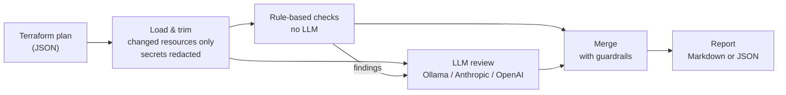

# iac-pr-reviewer

Reviews a Terraform plan and tells you, in plain English, which changes are risky before you apply them.

It combines two layers:

- **Rule-based checks**, which are fast, deterministic and always run. They catch destroys, IAM wildcards, open security groups, public S3 buckets, unencrypted storage and missing tags.
- **An LLM review** (local Ollama, Anthropic or OpenAI), which explains the impact and catches what rules can't, such as a publicly accessible database, a database with no backups, or audit logging being turned off.

## Example

Running it on a plan that creates a new Postgres database:

```bash
iac-review --plan plan.json
```

> ## 🟠 Terraform plan review — risk: **HIGH**
>
> The database instance is publicly accessible, has no backup retention, and is not encrypted. These settings pose a significant risk of data exposure and loss if merged as-is.
>
> **Plan:** 1 to create · 0 to update · 0 to replace · 0 to destroy
>
> | Severity | Resource | Issue | Source |
> |---|---|---|---|
> | 🟠 high | `aws_db_instance.analytics` | Storage is not encrypted at rest (storage_encrypted). | rule + AI |
> | 🟠 high | `aws_db_instance.analytics` | The database is publicly accessible, which exposes it to potential unauthorized access. | AI |
> | 🟠 high | `aws_db_instance.analytics` | `backup_retention_period` is 0 and `skip_final_snapshot` is `true`: data recovery is impossible if the database is deleted. | AI |

(The real output also has "Blast radius" and "Suggestion" columns.)

---

## How it works



1. **Load & trim.** Reads the `terraform show -json` output and keeps only resources that actually change. Updates are reduced to the attributes that differ, and sensitive values are replaced with `(sensitive)`.
2. **Rule-based checks.** Deterministic checks for destroys, IAM wildcards, open ports, public buckets, missing encryption and missing tags. They always run, even without an LLM.
3. **LLM review.** The model sees the trimmed plan plus the rule findings. It returns a risk level, a summary and extra findings in a strict schema.
4. **Merge.** Combines both sets. The LLM can add findings or raise severity, but never remove or downgrade a rule finding, and invented resources are dropped. If the LLM fails, the rule findings are still reported.
5. **Report.** A Markdown report (the future PR comment) or JSON, plus an exit code you can use to fail a build.

---

## Quick start

### 1. Prerequisites

| Tool | Needed for | Check |
|---|---|---|
| Node.js 20+ | everything | `node -v` |
| Ollama + a model | the LLM review, run locally | `ollama list` |
| Terraform | generating plans from your own code | `terraform -version` |

To set up the local model:

```bash
ollama pull qwen2.5:7b-instruct
```

If you don't have Terraform, run `./scripts/install-terraform.sh` (Ubuntu/WSL).

### 2. Install

```bash
git clone git@github.com:meirakrish/iac-pr-reviewer.git
cd iac-pr-reviewer
npm install
npm run build
npm link
```

`npm link` puts the `iac-review` command on your PATH.

### 3. Try it on a sample plan

The repo ships with 11 example plans in `evals/cases/`. No AWS account is needed:

```bash
iac-review --plan evals/cases/07-rds-public-unencrypted/plan.json
```

To see only the rule-based checks (instant, no LLM):

```bash
iac-review --plan evals/cases/04-open-ssh/plan.json --no-llm
```

### 4. Run it on your own Terraform

From your Terraform project:

```bash
terraform plan -out plan.tfplan
```

```bash
terraform show -json plan.tfplan > plan.json
```

```bash
iac-review --plan plan.json
```

Pass the **JSON** from `terraform show -json`, not the binary `plan.tfplan` file.

---

## Usage

```
iac-review --plan <file> [options]
```

| Option | What it does |
|---|---|
| `-p, --plan <file>` | Plan JSON to review. Use `-` to read from stdin. **Required.** |
| `-f, --format md\|json` | `md` (default) prints a readable report; `json` prints the structured result. |
| `-o, --out <file>` | Write the report to a file instead of the terminal. |
| `--fail-on <level>` | Exit with code `2` if risk is at or above `low` / `medium` / `high` / `critical`. |
| `--no-llm` | Rule-based checks only. |
| `--provider <name>` | `ollama`, `anthropic` or `openai`. See [Choosing an LLM](#choosing-an-llm). |
| `--model <name>` | Override the model name. |
| `--required-tags <list>` | Comma-separated tags every taggable resource must have, e.g. `Team,Environment`. |
| `-q, --quiet` | Hide progress messages. |

**Exit codes:** `0` OK · `1` error (bad file, invalid option) · `2` risk at or above `--fail-on`.

Examples:

```bash
iac-review --plan plan.json --fail-on high
iac-review --plan plan.json --format json --out review.json
terraform show -json plan.tfplan | iac-review --plan -
```

### Choosing an LLM

The provider is picked automatically:

1. If `ANTHROPIC_API_KEY` is set, it uses **Anthropic** (`claude-sonnet-5-5`).
2. Otherwise, if `OPENAI_API_KEY` is set, it uses **OpenAI** (`gpt-5-mini`).
3. Otherwise it uses local **Ollama** (`qwen2.5:7b-instruct`).

To force a choice, use `--provider` and `--model` (or `IAC_REVIEW_PROVIDER` / `IAC_REVIEW_MODEL`):

```bash
iac-review --plan plan.json --provider ollama --model qwen2.5-coder:7b
```

If the LLM is unavailable (Ollama not running, API error, timeout), the review **still completes** with the rule-based results, and the report says the AI review was skipped.

### Environment variables

Every option can also be set through the environment, which is handy for CI:

| Variable | Default | Purpose |
|---|---|---|
| `IAC_REVIEW_PROVIDER` | auto | Same as `--provider` |
| `IAC_REVIEW_MODEL` | per provider | Same as `--model` |
| `IAC_REVIEW_FAIL_ON` | `none` | Same as `--fail-on` |
| `IAC_REVIEW_NO_LLM` | | `true` = same as `--no-llm` |
| `IAC_REVIEW_REQUIRED_TAGS` | | Same as `--required-tags` |
| `ANTHROPIC_API_KEY` / `OPENAI_API_KEY` | | API keys for hosted providers |
| `OLLAMA_HOST` | `http://localhost:11434` | Ollama server URL |
| `IAC_REVIEW_NUM_CTX` | `16384` | Ollama context window (tokens). Lower it if the GPU runs out of memory. |
| `IAC_REVIEW_MAX_PLAN_CHARS` | `40000` | Maximum plan size sent to the LLM. The largest-risk changes are kept first. |
| `IAC_REVIEW_TIMEOUT_MS` | `180000` | LLM request timeout |

---

## What it checks

### Rule-based checks

| Check | Flags | Severity |
|---|---|---|
| Destroy / replace | Resources being deleted or recreated | **critical** for data stores (RDS, S3, DynamoDB, KMS…), otherwise high/medium |
| IAM wildcards | `Action: "*"`, `service:*`, `Resource: "*"`, `NotAction`, trust policies open to `Principal: "*"` | medium → **critical** (admin) |
| IAM privilege escalation | `iam:PassRole` on any role plus an action that launches compute (Lambda, EC2, ECS, Glue, CloudFormation…), or self-granting IAM actions (`iam:CreatePolicyVersion`, `iam:Attach*Policy`, `iam:CreateAccessKey`…) on `Resource: "*"` | high |
| Open ingress | `0.0.0.0/0` or `::/0` on security groups | **critical** for SSH/RDP/DB ports or all traffic, low for 80/443 |
| Public S3 | Public ACLs, disabled public-access-block, bucket policies open to `*` | high / **critical** |
| Unencrypted storage | RDS, Redshift, EBS, EFS, ElastiCache, EC2 volumes without encryption | medium / high |
| Missing tags | Taggable resources with no tags, or missing `--required-tags` | low |

### LLM review

On top of the rules, the LLM looks for risks that need context, for example:

- databases that are publicly accessible, or have no backups, final snapshot or deletion protection
- cross-account trust and other IAM risks the escalation rules don't cover
- audit logging or monitoring being turned off, KMS keys being deleted or disabled
- replacements that cascade to dependents (new IDs/ARNs, DNS, load balancers)

It also writes the plain-English summary and the blast-radius/suggestion text for each finding.

---

## Testing

### Unit tests

```bash
npm test
```

These cover the rule checks against real plans, sensitive-value redaction, the merge guardrails, the fallback when the LLM fails, the markdown output and config parsing. They don't need Ollama, an API key or Terraform.

```bash
npm run typecheck
```

### Evals: how good is the LLM?

`evals/cases/` holds 11 scenarios (4 safe, 7 risky), each with a real Terraform plan and the findings a good reviewer should report. The eval runs the full pipeline on every case and scores it:

```bash
npm run eval
```

```
✅ 01-safe-tag-update               risk low      (want low)  13.5s
✅ 07-rds-public-unencrypted        risk high     (want high-critical)  6.4s
✅ 09-iam-passrole-escalation       risk high     (want high-critical)  3.5s
...
                    ollama/qwen2.5:7b-instruct   prechecks only
risk accuracy                             100%    100%
finding recall                            100%     75%
finding precision                         100%    100%
LLM-only recall                           100%      0%
```

A failing case prints what went wrong underneath it, e.g. `missed: <resource>/<category>` or `under-rated: <resource> (got medium, want ≥high)`.

| Metric | Meaning |
|---|---|
| risk accuracy | Overall risk level within the expected range |
| finding recall | Share of expected findings reported, at the right severity |
| finding precision | Share of medium-or-higher findings that were expected (fewer false alarms means higher) |
| LLM-only recall | Share of risks that only the LLM can catch which it actually caught |

The "prechecks only" column is the rule-based baseline, so you can see how much the LLM adds.

Useful variations:

```bash
npm run eval -- --model qwen2.5-coder:7b
```

```bash
npm run eval -- --provider anthropic
```

```bash
npm run eval -- --case 09
```

The first compares a different model, the second uses a hosted provider (needs `ANTHROPIC_API_KEY`), and the third runs a single case. Full results are saved to `evals/results/` (git-ignored).

### Adding an eval case

1. Create `evals/cases/12-my-case/main.tf` with the resources you want to test. Don't include a provider block; `evals/provider.tf` is shared.
2. To test updates, destroys or replacements, add a `terraform.tfstate` describing the "before" state (see `06-rds-destroy` for an example).
3. Write `expected.json`:
   ```json
   {
     "description": "What this case tests",
     "risk": { "min": "high", "max": "critical" },
     "findings": [
       { "resource": "aws_db_instance.x", "category": "network-exposure", "minSeverity": "high", "llmOnly": true }
     ]
   }
   ```
4. Generate the plan:
   ```bash
   ./evals/generate-plans.sh
   ```
   This needs Terraform but no AWS account: it uses mock credentials and runs offline.

---

## Troubleshooting

| Problem | Fix |
|---|---|
| `AI review unavailable (could not connect…)` | Ollama isn't running. Start it (`ollama serve`, or `sudo systemctl start ollama`), or use `--no-llm`. |
| `cudaMalloc failed: out of memory` | On WSL, Windows apps that use the GPU (especially browsers) can block the model from loading even when `nvidia-smi` shows free memory. Close them and retry. If that doesn't help, lower the context with `IAC_REVIEW_NUM_CTX=8192`, or run `wsl --shutdown` from PowerShell and reopen WSL. |
| `ollama pull` fails with `Error: EOF` | An interrupted earlier download left partial files. Delete `/usr/share/ollama/.ollama/models/blobs/*-partial*` (needs sudo) and pull again. |
| `Plan is not valid JSON` | You passed the binary plan. Run `terraform show -json plan.tfplan > plan.json` first. |
| `iac-review: command not found` | Run `npm run build && npm link` in the repo, or use `npx tsx src/cli.ts` instead. |

---

## Project layout

```
src/
  cli.ts            command-line entry point
  review.ts         pipeline: prechecks → LLM → merge
  schema.ts         zod schemas for LLM output and the final result
  config.ts         flags / env vars / defaults
  plan/             load the plan JSON, trim it and redact secrets for the LLM
  prechecks/        rule-based checks (one file per check)
  llm/              provider setup (Ollama/Anthropic/OpenAI) and the prompt
  report/           merge rule + LLM findings, render markdown
test/               unit tests (vitest)
evals/              eval cases, runner and scorer
scripts/            helper scripts (Terraform install)
```
