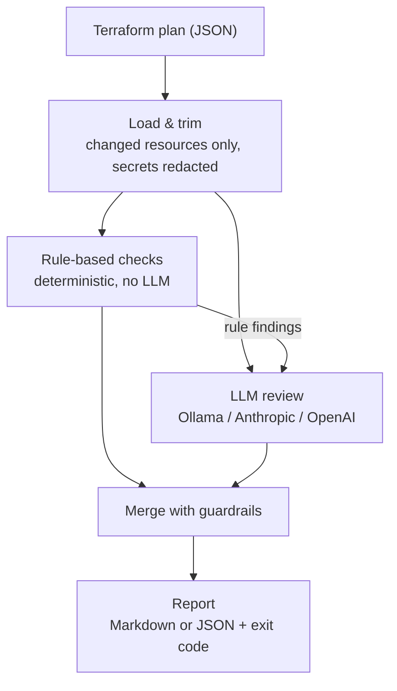

# iac-pr-reviewer

Reviews a Terraform plan and tells you, in plain English, which changes are risky before you apply them. Works with **AWS, Azure and GCP**.

It combines two layers:

- **Rule-based checks**, which are fast, deterministic and always run. They catch destroys, over-broad IAM, ports open to the internet, public storage, unencrypted storage or traffic, and missing tags.
- **An LLM review** (local Ollama, Anthropic or OpenAI), which explains the impact and catches what rules can't, such as a publicly accessible database, a database with no backups, or audit logging being turned off.

## Example

Running it on a plan that creates a new Postgres database:

```bash
iac-review --plan plan.json
```

> ## 🟠 Terraform plan review — risk: **HIGH**
>
> The database instance is publicly accessible, has no backup retention, and is not encrypted. These settings pose a significant risk of data exposure and loss if merged as-is.
>
> **Plan:** 1 to create · 0 to update · 0 to replace · 0 to destroy
>
> | Severity | Resource | Issue | Source |
> |---|---|---|---|
> | 🟠 high | `aws_db_instance.analytics` | Storage is not encrypted at rest (storage_encrypted). | rule + AI |
> | 🟠 high | `aws_db_instance.analytics` | The database is publicly accessible, which exposes it to potential unauthorized access. | AI |
> | 🟠 high | `aws_db_instance.analytics` | `backup_retention_period` is 0 and `skip_final_snapshot` is `true`: data recovery is impossible if the database is deleted. | AI |

(Abridged: the real report also has a risk badge and "Blast radius" and "Suggestion" columns.)

---

## How it works



1. **Load & trim.** Reads the `terraform show -json` output and keeps only resources that actually change. Updates are reduced to the attributes that differ, and sensitive values are replaced with `(sensitive)`.
2. **Rule-based checks.** Deterministic checks for destroys (including renames without a `moved` block), backups or versioning being turned off, over-broad IAM and privilege escalation, open ports, public storage, missing encryption and missing tags. They always run, even without an LLM.
3. **LLM review.** The model sees the trimmed plan plus the rule findings. It returns a risk level, a summary and extra findings in a strict schema.
4. **Merge.** Combines both sets. The LLM can add findings or raise severity, but never remove or downgrade a rule finding, and it can't replace a fix the rules computed exactly. LLM findings that can't be grounded in the plan are dropped: resources that aren't in it, updates whose new values are all unknown until apply, and low-severity "this is fine" notes. If the LLM fails, the rule findings are still reported.
5. **Report.** A Markdown report (ready to post as a PR comment) or JSON, plus an exit code you can use to fail a build.

---

## Quick start

### 1. Prerequisites

| Tool | Needed for | Check |
|---|---|---|
| Node.js 20.11+ | everything | `node -v` |
| Ollama + a model | the LLM review, run locally | `ollama list` |
| Terraform | generating plans from your own code | `terraform -version` |

To set up the local model:

```bash
ollama pull qwen3.5:9b
```

If you don't have Terraform, see [HashiCorp's install guide](https://developer.hashicorp.com/terraform/install). On Ubuntu you can run `./scripts/install-terraform.sh`.

### 2. Install

```bash
git clone https://github.com/meirakrish/iac-pr-reviewer.git
cd iac-pr-reviewer
npm install
npm run build
npm link
```

`npm link` puts the `iac-review` command on your PATH.

### 3. Try it on a sample plan

The repo ships with 25 example plans (AWS, Azure, GCP and Terraform modules) in `evals/cases/`. No cloud account is needed:

```bash
iac-review --plan evals/cases/07-rds-public-unencrypted/plan.json
```

To see only the rule-based checks (instant, no LLM):

```bash
iac-review --plan evals/cases/04-open-ssh/plan.json --no-llm
```

### 4. Try it against deployed infrastructure (Docker)

[`examples/localstack/`](examples/localstack/) deploys a small AWS stack to LocalStack (an AWS emulator in Docker) and reviews four "pull requests" against it: a safe change, a risky one, and a module rename with and without a `moved` block. No AWS account needed:

```bash
./examples/localstack/demo.sh all
```

### 5. Run it on your own Terraform

From your Terraform project:

```bash
terraform plan -out plan.tfplan
```

```bash
terraform show -json plan.tfplan > plan.json
```

```bash
iac-review --plan plan.json
```

Pass the **JSON** from `terraform show -json`, not the binary `plan.tfplan` file.

---

## Usage

```
iac-review --plan <file> [options]
```

| Option | What it does |
|---|---|
| `-p, --plan <file>` | Plan JSON to review. Use `-` to read from stdin. **Required.** |
| `-f, --format md\|json` | `md` (default) prints a readable report; `json` prints the structured result. |
| `-o, --out <file>` | Write the report to a file instead of the terminal. |
| `--fail-on <level>` | Exit with code `2` if risk is at or above `low` / `medium` / `high` / `critical`. Default `none`. |
| `--no-llm` | Rule-based checks only. |
| `--provider <name>` | `ollama`, `anthropic` or `openai`. See [Choosing an LLM](#choosing-an-llm). |
| `--model <name>` | Override the model name. |
| `--required-tags <list>` | Comma-separated tags (GCP: labels) every taggable resource must have, e.g. `Team,Environment`. |
| `-q, --quiet` | Hide progress messages. |

**Exit codes:** `0` OK · `1` error (bad file, invalid option) · `2` risk at or above `--fail-on`.

Examples:

```bash
iac-review --plan plan.json --fail-on high
iac-review --plan plan.json --format json --out review.json
terraform show -json plan.tfplan | iac-review --plan -
```

### Choosing an LLM

The provider is picked automatically:

1. If `ANTHROPIC_API_KEY` is set, it uses **Anthropic** (`claude-sonnet-5-5`).
2. Otherwise, if `OPENAI_API_KEY` is set, it uses **OpenAI** (`gpt-5-mini`).
3. Otherwise it uses local **Ollama** (`qwen3.5:9b`, about 6 GB of GPU memory).

To force a choice, use `--provider` and `--model` (or `IAC_REVIEW_PROVIDER` / `IAC_REVIEW_MODEL`):

```bash
iac-review --plan plan.json --provider ollama --model qwen2.5:7b-instruct
```

`qwen2.5:7b-instruct` is a lighter alternative (about 5 GB, ~35% faster) that misses some risks only an LLM can catch. Models that can "think" before answering, such as `qwen3.5`, run with thinking turned off: it's slower and doesn't help with this structured output.

If the LLM is unavailable (Ollama not running, API error, timeout), the review **still completes** with the rule-based results, and the report notes that the AI review was unavailable.

### Environment variables

The review options can also be set through the environment, which is handy for CI. Command-line flags take precedence.

| Variable | Default | Purpose |
|---|---|---|
| `IAC_REVIEW_PROVIDER` | auto | Same as `--provider` |
| `IAC_REVIEW_MODEL` | per provider | Same as `--model` |
| `IAC_REVIEW_FAIL_ON` | `none` | Same as `--fail-on` |
| `IAC_REVIEW_NO_LLM` | | `true`, `1` or `yes` = same as `--no-llm` |
| `IAC_REVIEW_REQUIRED_TAGS` | | Same as `--required-tags` |
| `ANTHROPIC_API_KEY` / `OPENAI_API_KEY` | | API keys for hosted providers |
| `OLLAMA_HOST` | `http://localhost:11434` | Ollama server address (`host:port` or a full URL) |
| `IAC_REVIEW_NUM_CTX` | `16384` | Ollama context window (tokens). Lower it if the GPU runs out of memory. |
| `IAC_REVIEW_MAX_PLAN_CHARS` | `40000` | Maximum plan size sent to the LLM, in characters. Deletes and replacements are kept first. |
| `IAC_REVIEW_MAX_OUTPUT_TOKENS` | `4096` | Cap on LLM output; stops a runaway generation quickly. |
| `IAC_REVIEW_TIMEOUT_MS` | `180000` | LLM request timeout |

---

## What it checks

### Rule-based checks

| Check | AWS | Azure | GCP | Severity |
|---|---|---|---|---|
| **Destroy / replace** | any resource; data stores (RDS, S3, DynamoDB, KMS…) | any resource; data stores (SQL, Storage, Cosmos DB, Key Vault, resource groups…) | any resource; data stores (Cloud SQL, buckets, BigQuery, KMS, projects…) | **critical** for data stores, otherwise high/medium. Renames are detected, see [modules](#terraform-modules) |
| **Data protection turned off** | DynamoDB point-in-time recovery or deletion protection, S3 versioning, RDS backups / deletion protection / final snapshot | — | Cloud SQL backups or deletion protection, bucket versioning | high (backups, versioning) / medium (deletion protection). Also when a replacement drops a protection the current resource has |
| **Network exposure** | security groups open to `0.0.0.0/0` / `::/0` | NSG rules from `*` / `Internet` / `0.0.0.0/0`; SQL/Postgres/MySQL firewall rules open to all IPs | firewall rules from `0.0.0.0/0`; Cloud SQL authorized networks `0.0.0.0/0` | **critical** for SSH/RDP/DB ports or all traffic, low for 80/443 |
| **IAM** | `Action`/`Resource: "*"`, `NotAction`, trust open to `Principal: "*"` | Owner / User Access Administrator assignments; custom roles with `*` | `roles/owner`, `roles/editor`, IAM-admin roles; `allUsers` / `allAuthenticatedUsers` members | medium → **critical** (full admin, public members, or Azure admin roles at subscription scope) |
| **Privilege escalation** | `iam:PassRole` + compute create; `iam:CreatePolicyVersion`, `iam:Attach*Policy`… on `*` | custom roles with `Microsoft.Authorization/*` write | custom roles with `actAs` + compute create, or `setIamPolicy`, SA key/token creation | high |
| **Public storage** | public ACLs, disabled public-access-block, bucket policies open to `*` | containers with `blob`/`container` access; accounts allowing public containers (low) | bucket IAM for `allUsers`/`allAuthenticatedUsers`; public ACLs | high / **critical** for public write |
| **Encryption** | unencrypted RDS, Redshift, EBS, EFS, ElastiCache, EC2 volumes | HTTP allowed or TLS < 1.2 on storage/SQL; Redis non-TLS port | Cloud SQL accepting unencrypted connections | medium / high |
| **Missing tags** | `tags` (incl. provider `default_tags`) | `tags` | `labels` (incl. provider `default_labels`) | low. Without `--required-tags`, only resources with no tags at all |

Azure and GCP encrypt disks and storage at rest by default, so for those clouds the encryption checks focus on traffic in transit.

### Terraform modules

Modules need no special setup: the plan lists every resource with its full address (for example `module.app.module.database.aws_db_instance.this`), so resources inside modules, nested modules and `count`/`for_each` instances are all checked like any other resource.

The tool also catches the most common module accident: **renaming or moving a module or resource without a `moved` block**. Terraform then plans to destroy the existing resources and create empty new ones. When a deleted resource reappears at a new address (same address inside a renamed module, or same name/identifier after a resource rename), the finding says so and gives the exact fix:

> 🔴 critical · `module.orders_db` · module.orders_db was renamed to module.orders_database without a `moved` block, so Terraform destroys all 2 resources in it and creates empty copies: aws_db_instance.this, aws_security_group.db.
> **Fix:** Add a `moved` block with `from = module.orders_db` and `to = module.orders_database`, then re-run the plan: it should show no destroy.

When the whole module moved, it's reported once for the module (listing the affected resources) with one module-level `moved` block as the fix. Otherwise it's one finding and one block per resource. The fix is also added to the summary. Renames that already use `moved` blocks are recognised as harmless, and the report shows them in the plan line (`· 3 moved`).

### LLM review

On top of the rules, the LLM looks for risks that need context, for example:

- databases that are publicly accessible, or have no backups, final snapshot or deletion protection
- cross-account trust and other IAM risks the rules don't cover
- audit logging or monitoring being turned off; keys (KMS, Key Vault, Cloud KMS) being deleted or disabled
- replacements that cascade to dependents (new IDs/ARNs, DNS, load balancers)

It also writes the plain-English summary and the blast-radius/suggestion text for each finding.

---

## Testing

### Unit tests

```bash
npm test
```

These cover the rule checks for all three clouds against real plans, rename detection, sensitive-value redaction, the merge guardrails, the LLM retry and fallback, the markdown output and config parsing. They don't need Ollama, an API key or Terraform.

Type checking and code formatting ([Prettier](https://prettier.io)):

```bash
npm run typecheck
```

```bash
npm run format
```

`npm run format:check` reports unformatted files without changing them.

### Evals: how good is the LLM?

`evals/cases/` holds 25 scenarios across AWS (01-11), Azure (12-16), GCP (17-22) and Terraform modules (23-25), 6 safe and 19 risky, each with a real Terraform plan and the findings a good reviewer should report. The eval runs the full pipeline on every case and scores it:

```bash
npm run eval
```

```
❌ 05-public-s3                     risk critical (want high-critical)  6.1s
     extra:       aws_s3_bucket.exports/public-storage (critical, llm)
✅ 13-azure-public-storage          risk high     (want high-critical)  8.1s
✅ 25-module-nested-public-db       risk critical (want critical)  8.3s
...
                            ollama/qwen3.5:9b   prechecks only
risk accuracy                             100%    100%
finding recall                            100%     84%
finding precision                          91%    100%
LLM-only recall                           100%      0%
```

A failing case prints what went wrong underneath it, e.g. `missed: <resource>/<category>`, `under-rated: <resource> (got medium, want ≥high)` or `extra: <resource>/<category>`. An "extra" isn't always wrong: in case 05 above the model correctly flags the bucket itself as public, while the expected findings name the policy and access-block resources. Read the finding before treating it as a false alarm.

| Metric | Meaning |
|---|---|
| risk accuracy | Overall risk level within the expected range |
| finding recall | Share of expected findings reported, at the right severity |
| finding precision | Share of medium-or-higher findings that were expected (fewer false alarms means higher) |
| LLM-only recall | Share of risks that only the LLM can catch which it actually caught |

The "prechecks only" column is the rule-based baseline, so you can see how much the LLM adds.

Useful variations:

```bash
npm run eval -- --model qwen2.5:7b-instruct
```

```bash
npm run eval -- --provider anthropic
```

```bash
npm run eval -- --case 09
```

The first compares a different model, the second uses a hosted provider (needs `ANTHROPIC_API_KEY`), and the third runs a single case. Full results are saved to `evals/results/` (git-ignored).

### Adding an eval case

1. Create `evals/cases/26-my-case/main.tf` with the resources you want to test. Don't include provider blocks: the generator adds the ones you need (from `evals/providers/`) based on the resource types you use. Local modules go in a `modules/` folder inside the case.
2. To test updates, destroys or replacements, add a `terraform.tfstate` describing the "before" state. The easiest way: write the "before" config in a scratch folder (with a provider file from `evals/providers/`), run `terraform plan -out p && terraform show -json p > before-plan.json` there, then convert that plan into a realistic state:
   ```bash
   node evals/state-from-plan.mjs before-plan.json > evals/cases/26-my-case/terraform.tfstate
   ```
   `--move NEW=OLD` stores resources at an older address instead (for example `--move module.new=module.old`). Cases 23 and 24 were built this way.
3. Write `expected.json`:
   ```json
   {
     "description": "What this case tests",
     "risk": { "min": "high", "max": "critical" },
     "findings": [
       { "resource": "aws_db_instance.x", "category": "network-exposure", "minSeverity": "high", "llmOnly": true },
       { "resource": "aws_db_instance.x", "category": "data-loss", "minSeverity": "medium", "optional": true }
     ]
   }
   ```
   - `llmOnly`: a risk the rules can't catch; tracked separately as "LLM-only recall".
   - `optional`: a valid finding that isn't required. It doesn't count toward recall, and reporting it isn't counted as a false alarm.
4. Generate the plan (pass part of a case name to regenerate only that case):
   ```bash
   ./evals/generate-plans.sh 26
   ```
   This needs Terraform (and `openssl` for Azure cases) but no cloud account. It uses mock credentials and runs offline. For Azure, it starts a fake Azure CLI and a tiny local Resource Manager stub (`evals/mock/`), because the azurerm provider authenticates as soon as it starts.

---

## Troubleshooting

| Problem | Fix |
|---|---|
| `AI review unavailable (could not connect…)` | Ollama isn't running. Start it (`ollama serve`, or `sudo systemctl start ollama`), or use `--no-llm`. |
| `cudaMalloc failed: out of memory` | The GPU doesn't have enough free memory to load the model. Close other GPU-heavy apps (browsers can use a lot) and retry, or lower the context with `IAC_REVIEW_NUM_CTX=8192`. |
| `ollama pull` fails with `Error: EOF` | An interrupted earlier download left partial files. Delete the `*-partial*` files in Ollama's models folder (on Linux: `/usr/share/ollama/.ollama/models/blobs/`, needs sudo) and pull again. |
| `Plan is not valid JSON` | You passed the binary plan. Run `terraform show -json plan.tfplan > plan.json` first. |
| `iac-review: command not found` | Run `npm run build && npm link` in the repo, or use `npx tsx src/cli.ts` instead. |

---

## Project layout

```
src/
  cli.ts            command-line entry point
  review.ts         pipeline: prechecks → LLM → merge
  schema.ts         zod schemas for LLM output and the final result
  config.ts         flags / env vars / defaults
  plan/             load the plan JSON, detect renames, trim it and redact secrets for the LLM
  prechecks/        rule-based checks (one file per check)
  llm/              provider setup (Ollama/Anthropic/OpenAI) and the prompt
  report/           merge rule + LLM findings, render markdown
test/               unit tests (vitest)
evals/
  cases/            one folder per scenario: main.tf, optional tfstate, plan.json, expected.json
  providers/        offline provider configs (aws, azurerm, google)
  mock/             fake Azure CLI + Resource Manager stub for offline Azure plans
  run.ts, score.ts  eval runner and scorer
  state-from-plan.mjs
                    build a realistic terraform.tfstate for a case from a plan
examples/
  localstack/       try it against infrastructure deployed to LocalStack in Docker
scripts/            helper scripts (Terraform install)
```
